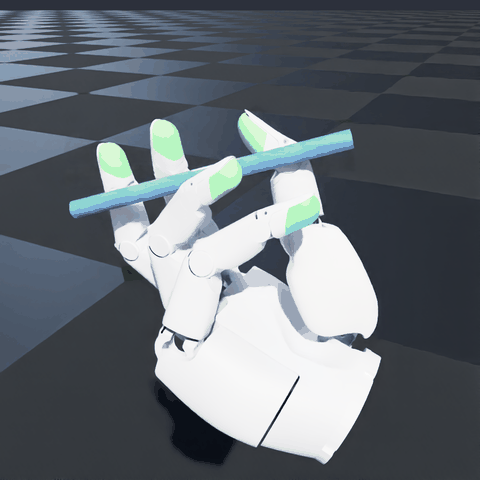
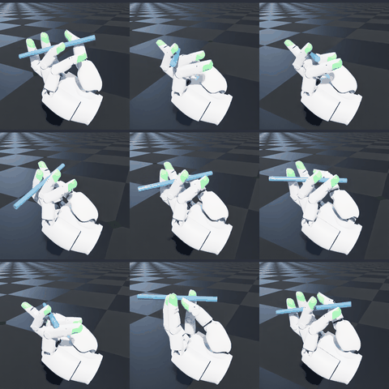
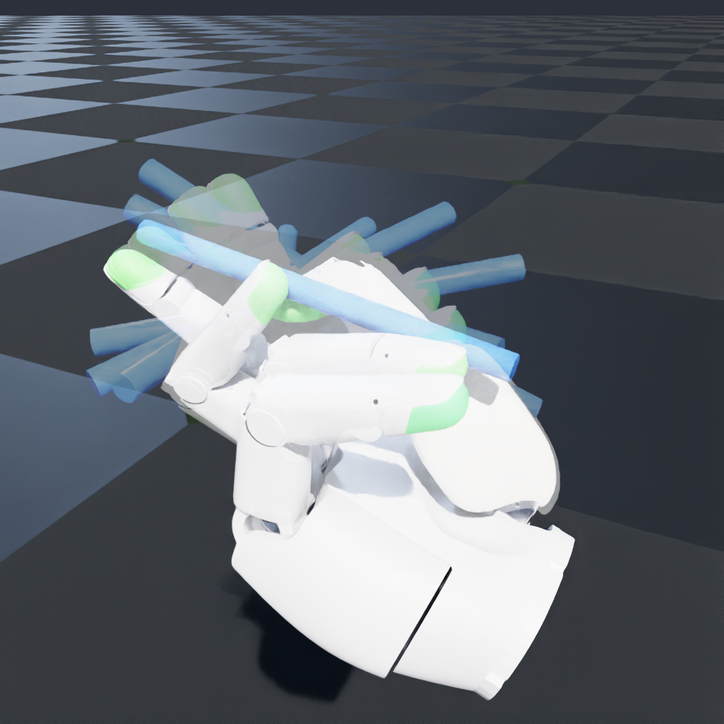
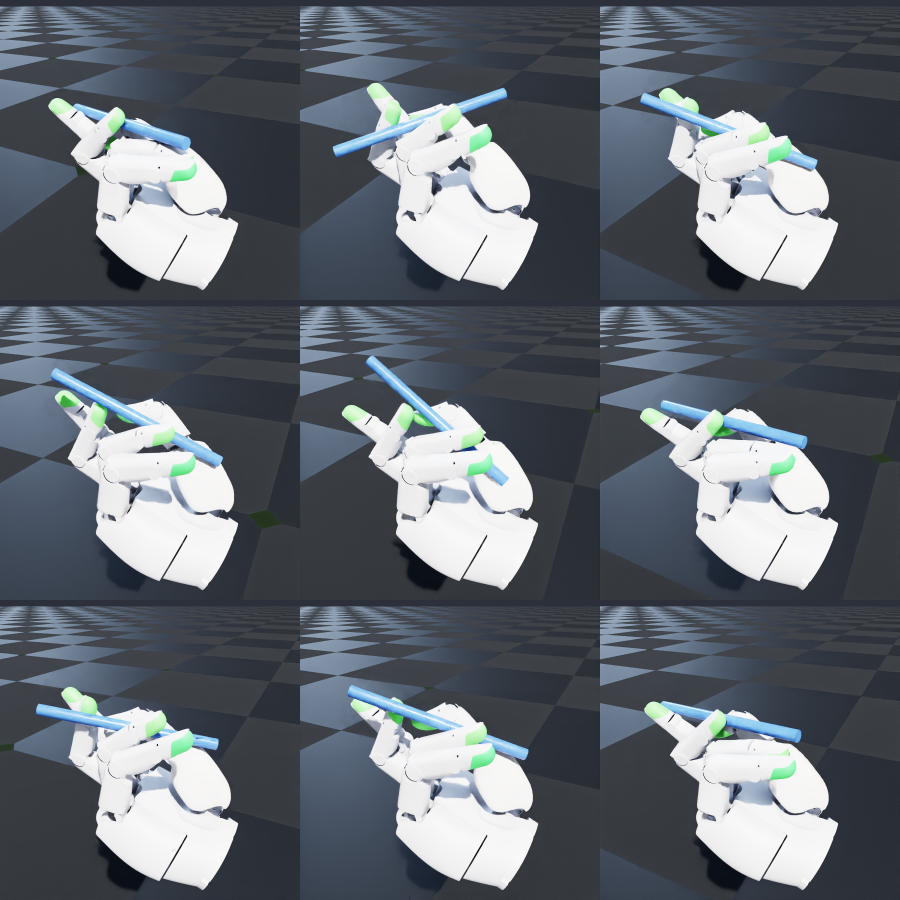
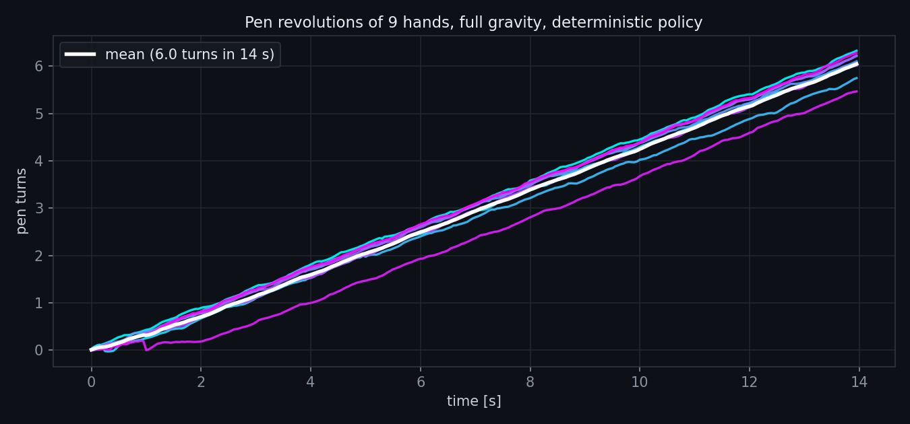
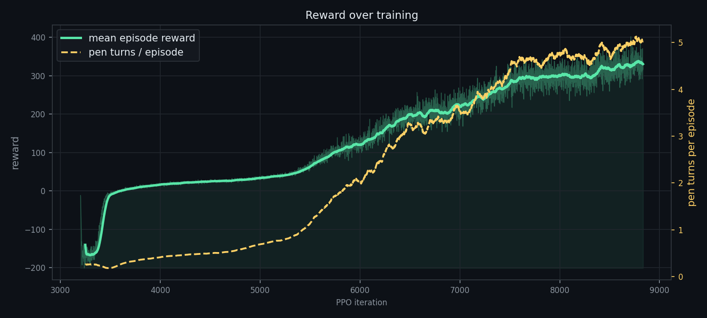
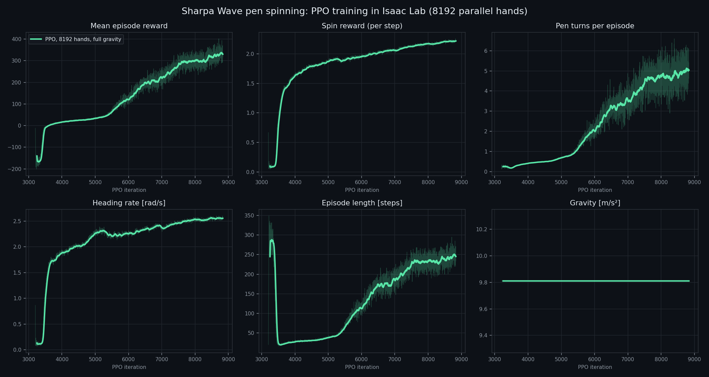

<div align="center">

# ✍️ DexHand Pen Rotation

### Teaching the Sharpa Wave robotic hand to spin a pen with Reinforcement Learning in NVIDIA Isaac Sim


-blue)


 

*Left: one hand spinning the pen. Right: nine hands running the same policy in parallel.*

</div>

---

## ✨ Overview

A **22-DoF Sharpa Wave** right hand learns to **spin a pen around its fingers** under full gravity.
The policy is trained **entirely in simulation** with **PPO** on **8,192 hands in parallel** on a single GPU
in **NVIDIA Isaac Sim 6.2 / Isaac Lab 3.0**.

- 🖐️ **Real hand model**: the official Sharpa Wave USD with its tuned PD gains and fingertip elastomer materials.
- 🖊️ **Pen**: a 14 cm, 15 g cylinder (r = 4.5 mm), with randomized mass and friction.
- 🔄 **Honest spin reward**: only the pen's real net rotation earns reward (details below).
- ⚡ **Massively parallel**: 8,192 environments, ~33 iterations/min on one NVIDIA L40S.

## 🎬 Results

<div align="center">
 

*Left: long-exposure view of the pen sweeping around the fingers. Right: nine hands mid-spin.*
</div>

<div align="center">


*Total pen turns over time for each of nine hands (deterministic policy, full gravity).*
</div>

| Metric (256 hands × 20 s, deterministic policy, 9.81 m/s² gravity) | Value |
|---|---|
| 🔄 Pen revolutions per episode | **7.8 turns** on average (best 9.2) |
| ⏱️ Spin speed | **2.7 rad/s** (~26 rpm) |
| 🫳 Episodes that end in a drop | **~10 %** |

## 🧠 How it works

1. 👀 **Observe** (130 values): joint positions, velocities and targets, the last action, pen pose, axis and velocity,
   fingertip positions relative to the pen, fingertip contact forces, and gravity.
2. 🧩 **Decide**: an **[512, 256, 128] MLP** (ELU, observation normalization) trained with **PPO** (RSL-RL).
3. ✋ **Act** (22 values): small changes to the joint position targets (up to 1/24 rad per step).
   PD control runs at **120 Hz** and the policy at **20 Hz**.
4. 🔁 **Repeat**: 8,192 hands train in parallel. Each episode lasts 20 s, and it ends early if the pen
   drops 5 cm, drifts 8 cm from its start, or tilts more than 50°.

### 🎯 Reward

The reward at every policy step is

```
reward =  1.0  * clip(heading_rate, -3, +3)      # spin
        - 1.0  * |pen_axis_z|                    # keep the pen horizontal
        - 5.0  * ||pen_pos - pen_start||         # keep the pen in place
        - 0.3  * ||pen_linear_velocity||
        - 0.1  * ||q - q_default||²              # stay near the natural hand pose
        - 0.01 * ||τ||²  - 0.05 * |τ · q̇|        # torque and mechanical work
        - 0.01 * ||a_t - a_{t-1}||²              # smooth actions
        - 10   * [pen dropped]
```

**The spin term** is the key. It measures the **heading** (yaw) of the pen's long axis, and rewards how much that
heading changed during the policy step:

```python
yaw  = atan2(pen_axis.y, pen_axis.x)
d    = wrap_to_pi(yaw - prev_yaw)         # heading change over this step
heading_rate = d / step_dt                # rad/s
spin_reward  = clip(heading_rate, -3, +3) # symmetric clip
```

- 🛞 **Rolling** the pen about its own long axis doesn't change its heading, so it earns nothing.
- 〰️ **Jiggling** inside a step earns nothing, because only the change from one step to the next counts.
- ↔️ **Swinging back and forth** earns nothing, because the clip is symmetric and forward and backward swings cancel.

The only way to collect reward is to keep the pen turning in one direction, i.e. to really spin it.

### 🎲 Robustness

- **Domain randomization**: pen friction 0.4–1.0, pen mass ×0.7–1.4, joint observation noise.
- **Random pushes**: occasional forces on the pen of up to half its weight.
- **Start states**: episodes begin from a cache of 50,000 stable pen grasps (`cache/pen_grasps.npy`,
  generated by `scripts/gen_grasp.py`).
- **Gravity curriculum** (optional): gravity starts at 2 m/s² and rises to 9.81 m/s² as the hand stops dropping the pen.

## 📈 Training

<div align="center">


*Mean episode reward (green) and pen turns per episode (yellow) during training.*



*Episode reward, spin reward, pen turns, spin speed, episode length and gravity.*
</div>

The released policy was warm-started from an earlier checkpoint (iteration 3,200). It was then trained with the
reward above for **5,400 more PPO iterations at full gravity**, 8,192 hands, ~2.8 h on one NVIDIA L40S.

## 📦 Pretrained weights

```
weights/
├── model_8600.pt      # RSL-RL checkpoint (play / resume)
└── params/            # exact env.yaml + agent.yaml used for training
```

## 🚀 Getting started

### 1. Install Isaac Sim 6.2 + Isaac Lab 3.0

Follow the [Isaac Lab installation guide](https://isaac-sim.github.io/IsaacLab/), then install this package into
the same environment. It registers its tasks through the `isaaclab.tasks` entry point:

```bash
git clone https://github.com/KiaRational/DexHandPenRotation.git
cd DexHandPenRotation
pip install -e . --no-deps          # or: uv pip install -e . --no-deps
```

Tasks: `PenSpin-Sharpa` (training), `PenSpin-Sharpa-Play` (evaluation), `PenSpin-Sharpa-Grasp` (grasp cache).

### 2. Watch the pretrained policy 👀

```bash
isaaclab play --rl_library rsl_rl --task PenSpin-Sharpa-Play --checkpoint weights/model_8600.pt --viz kit
```

### 3. Train your own 🏋️

```bash
# from scratch (gravity curriculum on)
isaaclab train --rl_library rsl_rl --task PenSpin-Sharpa --num_envs 8192 --max_iterations 10000

# continue from the released weights at full gravity
isaaclab train --rl_library rsl_rl --task PenSpin-Sharpa --num_envs 8192 \
    --checkpoint weights/model_8600.pt env.gravity_start=9.81
```

### 4. Evaluate and render 🎥

```bash
python scripts/rollout.py  --checkpoint weights/model_8600.pt                  # turns, drops, spin speed -> *_eval.json
python scripts/rollout.py  --checkpoint weights/model_8600.pt --video          # 2x2 RTX video
python scripts/showcase.py --checkpoint weights/model_8600.pt                  # the GIFs and figures in media/
python scripts/plot_training.py --main logs/rsl_rl/pen_spin_sharpa_ppo/<run>   # training curves
python scripts/gen_grasp.py --num_envs 8192                                    # regenerate the grasp cache
```

## 🗂️ Project structure

```
source/pen_spin/tasks/pen_spin/
├── pen_spin_env_cfg.py      # scene, hand + pen, PD gains, reward weights, randomization, curriculum
├── pen_spin_env.py          # DirectRLEnv: observations, actions, reward, terminations, resets
├── grasp_env.py             # grasp-cache generator (stable start states)
└── agents/rsl_rl_ppo_cfg.py # PPO hyper-parameters
assets/SharpaWave/           # Sharpa Wave right-hand USD (Apache-2.0)
cache/pen_grasps.npy         # 50k start grasps
scripts/                     # evaluation, rendering, plotting, grasp generation
weights/                     # final pretrained policy
media/                       # GIFs and figures
```

## 🙏 Acknowledgements

This project builds on these open-source projects. Huge thanks to their authors:

- 🖐️ [sharpa-robotics/sharpa-urdf-usd-xml](https://github.com/sharpa-robotics/sharpa-urdf-usd-xml): the Sharpa Wave hand model (USD)
- 🔄 [sharpa-robotics/sharpa-rl-lab](https://github.com/sharpa-robotics/sharpa-rl-lab): the reference in-hand rotation task, hand setup and PD scheme
- 🟩 [isaac-sim/IsaacLab](https://github.com/isaac-sim/IsaacLab) and [NVIDIA Isaac Sim](https://developer.nvidia.com/isaac/sim): simulation and RL framework
- 🧠 [leggedrobotics/rsl_rl](https://github.com/leggedrobotics/rsl_rl): the PPO implementation

## 📄 License

The Sharpa Wave hand model in `assets/SharpaWave/` is © Sharpa Group under the
**[Apache License 2.0](assets/SharpaWave/LICENSE.txt)** (see `assets/SharpaWave/NOTICE.txt`).

<div align="center">

⭐ If you find this project useful, consider giving it a star! ⭐

</div>
